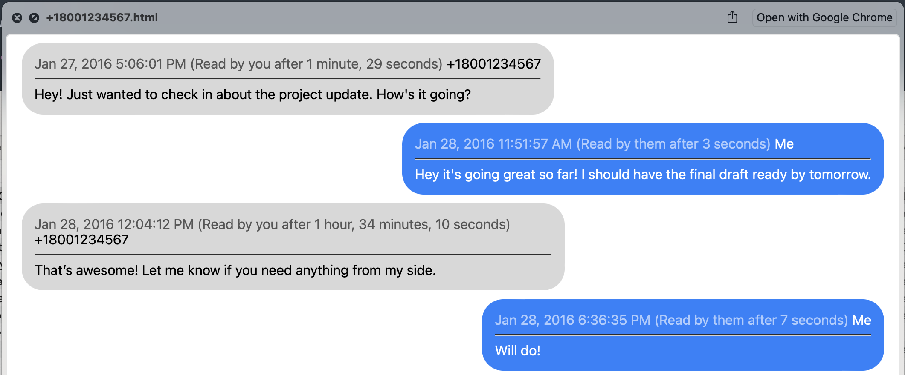
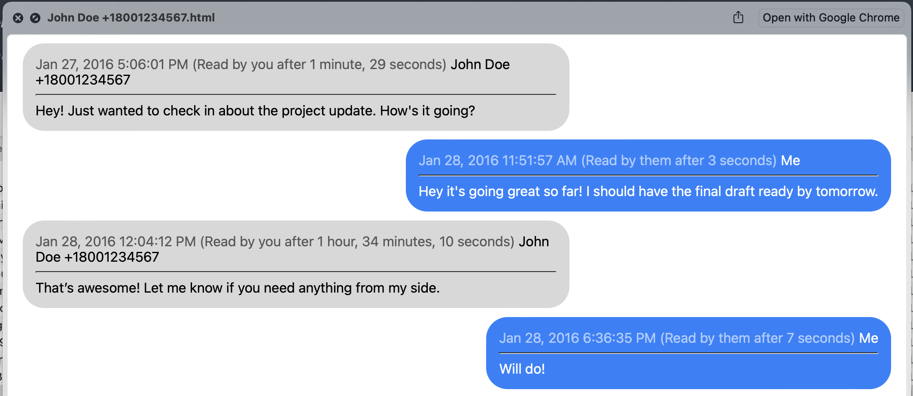

# imessage-exporter-name-enhancer  
***Enhances [iMessage Exporter](https://github.com/ReagentX/imessage-exporter) by adding contact names to HTML/TXT message files and renaming files to include contact names.***

[iMessage Exporter](https://github.com/ReagentX/imessage-exporter) is incredibly useful, but it lacks one key feature: displaying contact names next to phone numbers (both inside message files and in their filenames).  
This script enhances your exported messages by replacing phone numbers with names from your contacts and renaming files for easier navigation.

---

## 🌍 Export Your Contacts to a vCard (`.vcf` File)

You can export your contacts to a `.vcf` file using **iCloud.com**, the **Contacts app on macOS**, or your **iPhone** directly.

### iCloud.com

1. Make sure your iPhone contacts are synced to iCloud.
2. Log in to [iCloud Contacts](https://www.icloud.com/contacts).
3. Select all contacts (`Cmd+A` on Mac or `Ctrl+A` on Windows).
4. Click the **share icon** and choose **Export vCard**.

### macOS Contacts App

1. Make sure your iPhone contacts are synced to iCloud.
2. Open **Contacts**.
3. Select all (`Cmd+A`).
4. Go to `File` → `Export` → `Export vCard`.

### iPhone

1. Open the **Contacts** app.
2. Tap **Lists**, then hold a list and choose **Export**.
3. Confirm which details you want to include and tap **Done**.
4. Share or email the `.vcf` file to yourself to download to your computer.

---

## 🧰 Setup & Installation

### macOS/Linux

1. Open Terminal and navigate to the script directory.
2. Make it executable:
   ```bash
   chmod +x run_contact_parser.sh
   ```

3. Run the script:

   ```bash
   ./run_contact_parser.sh path_to_vcf path_to_imessage_export [options]
   ```

### Windows

1. Open **Command Prompt**.
2. Navigate to the script directory.
3. Run:

   ```cmd
   run_contact_parser.bat path_to_vcf path_to_imessage_export [options]
   ```

---

## ⚙️ Arguments & Options

### Optional Parameters

| Option            | Description                                                                                                                                                     | Example  |
| ----------------- | --------------------------------------------------------------------------------------------------------------------------------------------------------------- | -------- |
| `-r`, `--replace` | **Replace phone numbers entirely** with contact names (instead of showing both).<br>Default behavior adds both name and number (e.g., “John Doe +14151234567”). | `-r`     |
| `-c`, `--country` | Specify a **default country code** for phone number normalization.<br>Useful for local numbers without country prefixes. Defaults to `US`.                      | `-c GB`  |
| `-m`, `--maxlen`  | Set the maximum filename length for renamed files. Defaults to `0` which uses the 255-character system limit.                  | `-m 80` |

---

## 🧭 Examples

**1. Basic Usage (Default Behavior)**
Adds contact names next to phone numbers and renames files with names.

```bash
./run_contact_parser.sh contacts.vcf imessage_export_dir
```

**2. Replace Phone Numbers Entirely**
Removes phone numbers and replaces them with just the contact name.

```bash
./run_contact_parser.sh contacts.vcf imessage_export_dir -r
```

Example result:

> “John Doe: Hey!” instead of “John Doe +14151234567: Hey!”

**3. Handle International Numbers (e.g., UK)**
Provide a country code to correctly format local numbers.

```bash
./run_contact_parser.sh contacts.vcf imessage_export_dir -c GB
```

**4. Enforce a Maximum Filename Length**

```bash
./run_contact_parser.sh contacts.vcf imessage_export_dir -m 100
```

**5. Combine All Options**

```bash
./run_contact_parser.sh contacts.vcf imessage_export_dir -r -c GB -m 100
```

---

## ⚠️ Notes & Recommendations

* **Run this only on a fresh export from iMessage Exporter (or from a copy).**
  Re-running it on an already processed folder may duplicate names, for example:
  `John Doe John Doe +14151234567` instead of `John Doe +14151234567`.
* Requires **Python 3.6 or higher** (recommended **3.8+** for best performance).
* The launcher scripts automatically install dependencies:

  * `vobject`
  * `phonenumbers`
* Automatically truncates filenames safely to prevent cross-platform errors.

---

## 🖼️ Example Results

**Without Contact Parser:**


**With Contact Parser:**

